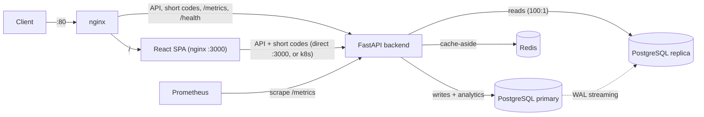

# Distributed URL Shortener

A production-shaped URL shortening service: **FastAPI + PostgreSQL primary/replica + Redis
cache-aside**, with click analytics, Prometheus metrics, a React UI, and a Helm chart for k3s.


> **Working on the code?** The [Developer Guide](docs/DEVELOPER_GUIDE.md) explains the architecture,
> the execution flow of every request, and each module file by file. This README is the front door;
> the guide is the deep dive.

---

## Architecture



| Concern | Design |
|---|---|
| Reading a short code | Redis first; on miss, read replica + repopulate (cache-aside) |
| Writing a short code | Primary only; cache warmed before returning (read-your-writes) |
| Short code format | Auto-increment `BIGSERIAL` id → Base62 (`0-9a-zA-Z`), collision-free by construction |
| Analytics | One `click_events` row + atomic counter bump per redirect, on the primary |
| Redirect semantics | `302` by default (complete analytics), `301` opt-in per link (browser-cached) |
| Observability | Custom Prometheus counters/histogram + auto-instrumented HTTP metrics |

## Quick start

Prerequisites: Docker with the Compose plugin. Nothing else is needed locally.

```bash
cp .env.example .env          # optional: override POSTGRES_PASSWORD / image refs
make up                       # docker compose up -d --build

# Smoke test
curl -s -X POST http://localhost/api/v1/shorten \
  -H "Content-Type: application/json" \
  -d '{"url": "https://example.com/very/long/path"}'
# {"short_url":"http://localhost/1","short_code":"1","original_url":"https://example.com/very/long/path"}

curl -si http://localhost/1 | head -3      # 302 + Location: https://example.com/very/long/path
curl -s  http://localhost/api/v1/stats/1   # total_clicks, recent_clicks
```

| Endpoint | URL | Notes |
|---|---|---|
| App (nginx edge) | http://localhost | the normal entry point |
| App (frontend container) | http://localhost:3000 | self-contained: proxies `/api` and short codes to the backend |
| API docs (Swagger) | http://localhost:8000/docs | |
| Prometheus metrics (raw) | http://localhost/metrics | |
| Prometheus UI | http://localhost:9090 | |

Stop with `make down`; wipe volumes with `make reset`.

## API

| Method | Path | Description | Success | Errors |
|---|---|---|---|---|
| `POST` | `/api/v1/shorten` | Create a short URL (`url`, optional `redirect_type` 301/302) | `201` | `422` invalid body |
| `GET` | `/{short_code}` | Redirect to the target URL | `301`/`302` | `404` unknown/inactive |
| `GET` | `/api/v1/stats/{short_code}` | Click analytics (total + last 100 events) | `200` | `404` unknown |
| `GET` | `/health` | Liveness (process-only; does not check DB/Redis) | `200` | — |
| `GET` | `/metrics` | Prometheus exposition | `200` | — |

**Create** — `POST /api/v1/shorten`

```json
{ "url": "https://example.com/long/path", "redirect_type": 302 }
```

```json
{ "short_url": "http://localhost/1", "short_code": "1", "original_url": "https://example.com/long/path" }
```

**Stats** — `GET /api/v1/stats/1`

```json
{
  "short_code": "1",
  "original_url": "https://example.com/long/path",
  "total_clicks": 2,
  "created_at": "2026-10-14T11:59:00Z",
  "recent_clicks": [
    { "id": 2, "clicked_at": "2026-10-14T12:00:00Z", "ip_address": "203.0.113.7",
      "user_agent": "curl/8.5.0", "referrer": null, "country": null }
  ]
}
```

## Design decisions & trade-offs

| Decision | Rationale | Trade-off accepted |
|---|---|---|
| Counter → Base62 codes (not hashing) | Collision-free by construction; no lookup on write | Sequential codes are guessable; mitigated by random offset (exercise) |
| `302` default, `301` opt-in | Every click reaches the server → complete analytics | Repeat clicks pay a server round trip |
| Cache-aside + warm on create | Cuts read load ~100:1 *and* bridges replication lag (read-your-writes) | Mutable fields (`is_active`) stay cached until TTL (1 h) |
| Primary for writes, replica for reads | Read scalability with a single writer | Replica-lag window on cold cache; clicks/stats are eventually consistent |
| Analytics inline, atomic SQL increment | Simple, no lost updates, no extra infrastructure | Adds latency to redirects; hot-row contention at extreme rates |
| Postgres `BIGSERIAL` as the counter | One source of truth; trivial correctness | Creation is single-primary-bound (no distributed IDs) |
| Migrations on app start | Zero-friction local/canary deploys | Racy with multiple replicas in k8s — use a Job/advisory lock in prod |

The full reasoning, including the 301/302 analytics trade-off and cache-stampede discussion, is in
the [Developer Guide](docs/DEVELOPER_GUIDE.md).

## Observability

`GET /metrics` exposes auto-instrumented HTTP metrics plus:

| Metric | Type | Labels | Use |
|---|---|---|---|
| `urlshortener_urls_created_total` | Counter | — | creation throughput |
| `urlshortener_redirects_total` | Counter | `status_code`, `cache_hit` | redirect throughput split by cache behavior |
| `urlshortener_redirect_duration_seconds` | Histogram | — | redirect latency (p50/p95/p99) |

```promql
# cache hit ratio
sum(rate(urlshortener_redirects_total{cache_hit="true"}[5m]))
  / sum(rate(urlshortener_redirects_total[5m]))

# p95 redirect latency
histogram_quantile(0.95, sum(rate(urlshortener_redirect_duration_seconds_bucket[5m])) by (le))
```

> `/metrics` is unauthenticated and `/health` is a shallow liveness probe — see the guide's
> "Known limitations" for the production hardening list.

## Testing

Tests need a reachable Postgres (with a `test_urlshortener` database) and Redis:

```bash
docker compose up -d db redis
docker compose exec db psql -U postgres -c "CREATE DATABASE test_urlshortener;"
make test          # 18 tests: Base62, shorten, redirect/cache, analytics
make lint          # ruff check backend/
```

What the CI pipeline does on every push/PR — and what runs only on `main`:

```
lint (ruff + mypy) → test (pytest with postgres + redis service containers) → build & push to GHCR
```

## Deployment

### Docker Compose

- **Dev**: `docker-compose.yml` — builds images, exposes every service for inspection.
- **Prod-style**: `docker-compose.prod.yml` — prebuilt GHCR images, `restart: unless-stopped`,
  no source mounts:

```bash
cp .env.example .env    # set BACKEND_IMAGE / FRONTEND_IMAGE / POSTGRES_PASSWORD
docker compose -f docker-compose.prod.yml up -d
```

### Kubernetes (k3s + Helm)

```bash
# 1. Publish images (CI does this on main), then point the values at your registry:
#    backend.image.repository / frontend.image.repository in helm/url-shortener/values.yaml
#    or: --set backend.image.repository=ghcr.io/<you>/.../backend

# 2. Install
kubectl create namespace url-shortener
helm install url-shortener ./helm/url-shortener --namespace url-shortener

# 3. Verify
kubectl get pods,svc -n url-shortener
helm lint ./helm/url-shortener
echo "127.0.0.1 url-shortener.local" | sudo tee -a /etc/hosts
```

Upgrades and rollbacks are ordinary Helm operations:

```bash
helm upgrade url-shortener ./helm/url-shortener -n url-shortener --set backend.image.tag=v1.0.1
helm history  url-shortener -n url-shortener
helm rollback url-shortener 1 -n url-shortener
```

Notes before you trust it in a cluster:

- Set real image repositories and a real `postgres.password` (the defaults are development values).
- Keep `createNamespace=false` (default) **or** `--set createNamespace=true` — never both
  (Helm refuses to adopt a manually-created namespace).
- Short-code paths (`/{code}`) reach the backend through the frontend image's nginx proxy (it mirrors
  the compose edge), so the Ingress only routes `/api` and `/` — see the
  [Kubernetes section](docs/DEVELOPER_GUIDE.md#96-kubernetes--helm) of the guide.
- With `backend.replicas > 1`, migrations can race on rollout; move them to a Helm hook Job.

## Operations cheat sheet

| Task | Command |
|---|---|
| Full stack up / down / wipe | `make up` / `make down` / `make reset` |
| Logs (all / backend) | `make logs` / `docker compose logs -f backend` |
| psql on primary / replica | `make psql` / `make psql-replica` |
| Watch cache-aside live | `docker compose exec redis redis-cli monitor` |
| Verify replication | `docker exec pg-primary psql -U postgres -d urlshortener -c "SELECT state FROM pg_stat_replication;"` |
| Replication lag | `docker exec pg-replica psql -U postgres -d urlshortener -c "SELECT now() - pg_last_xact_replay_timestamp();"` |
| Migrations | `make migrate` / `make revision NAME="..."` |

Troubleshooting table, verification checklist, and the 20-item hardening roadmap live in the
[Developer Guide](docs/DEVELOPER_GUIDE.md#13-troubleshooting).

## Project layout

```
backend/             FastAPI app (api/, services/, models, cache, metrics) + Alembic + 18 tests
frontend/            React 18 + Vite + Tailwind; image served by nginx (also proxies API + short codes)
nginx/               Reverse proxy: API/short codes → backend, everything else → SPA
helm/url-shortener/  Chart: backend, frontend, Postgres primary/replica, Redis, Ingress, probes
prometheus/          Scrape configuration
scripts/             Postgres init (replication role + slot)
docs/                Developer Guide (architecture, execution flows, operations)
.github/workflows/   CI: lint → test → build/push to GHCR
docker-compose*.yml  Dev and prod-style stacks
pyproject.toml       Ruff configuration used by CI and `make lint`
```

## Documentation

- **[Developer Guide](docs/DEVELOPER_GUIDE.md)** — boot sequence, request flows with sequence
  diagrams, module-by-module reference, cross-cutting concepts (cache consistency, replication lag),
  testing internals, operations playbook, troubleshooting, guided exercises.

## License

[MIT](LICENSE)
